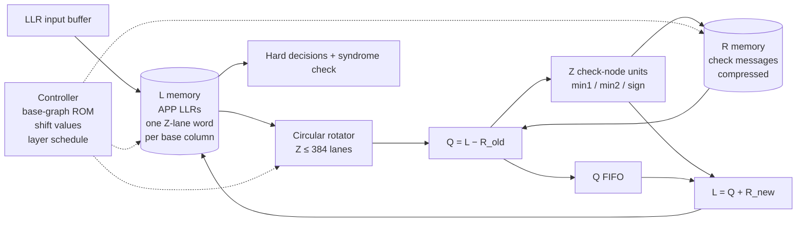

# 00 · The application: what are we building?

> **In one sentence:** a 5G LDPC decoder takes a block of noisy *soft* bits
> from the radio and returns the most likely original data bits. It does this
> by passing small numbers back and forth along a fixed, sparse wiring pattern.
> That wiring pattern is made almost entirely of circular shifts.

---

## 1. Where the decoder sits in a 5G receiver

```
antenna → RF/ADC → OFDM demod → channel estimation/equalization
        → demapper (QAM symbols → soft bits, "LLRs")
        → rate recovery (de-interleave, undo puncturing/repetition, insert known zeros)
        → ┌────────────────────┐
          │    LDPC DECODER    │   ← this tutorial
          └────────────────────┘
        → CRC check → HARQ (ask for retransmission if CRC fails) → MAC / higher layers
```

The transmitter added parity bits to every *code block* using an LDPC code.
The receiver's job is to use those parity bits to repair errors the channel
introduced.

## 2. What goes in and what comes out

**Input, per code block:**

| Item | What it is | Typical form in hardware |
|---|---|---|
| LLRs | one *log-likelihood ratio* per transmitted bit. Sign = best guess (positive → 0), magnitude = confidence | signed 6–8 bit integers, streamed in |
| Base graph | BG1 (large blocks, higher rates) or BG2 (small blocks, lower rates) | 1 bit |
| Lifting size Z | one of **51** legal values from 2 to 384 | 9-bit value + set index (iLS) |
| Number of rows/layers to use | depends on the code rate the transmitter chose | small integer |
| Max iterations | latency/quality trade-off | small integer |

**Output, per code block:**

| Item | What it is |
|---|---|
| K decoded bits | the hard decisions on the information part |
| Status | did all parity checks pass? how many iterations were used? |

## 3. What the decoder must do (functional spec)

1. **Store** the incoming LLRs in an internal memory (the *APP* or *L* memory).
2. **Iterate**: for each parity-check row of the code, read the bits that row
   involves, compute corrections with a simple min/sign rule (Min-Sum, chapter 01),
   and write updated LLRs back.
3. **Stop** when every parity check is satisfied or the iteration limit is hit.
4. **Output** the signs of the information LLRs.

The arithmetic in step 2 is small: subtract, compare, find the two smallest
magnitudes, XOR signs, add. **The hard part is the data movement.** Each row
needs a different set of LLRs, and they arrive in the wrong order. They have
to be rearranged before the compute lanes can use them, and rearranged back
afterwards. In 5G that rearrangement is always a **circular rotation of a
Z-element vector**. The amount of rotation is different for every block, and
Z itself changes from one code block to the next.

## 4. Why this is a hardware design problem

| Requirement | Consequence for the RTL |
|---|---|
| 51 different Z values | the rotator must rotate *any* length ≤ 384, not just a power of two |
| Z changes per code block | everything is run-time configurable; no per-Z hardware |
| Shift changes every cycle | the rotator is combinational/pipelined, reconfigured every clock |
| Gb/s throughput | Z lanes (up to 384) work in parallel, so the rotator moves 384 × W bits per cycle |
| Small Z is common too | at Z = 24 a 384-lane design is 94% idle unless it can process several code blocks at once ("multi-frame") |
| Rotator is on the critical path | its depth and its *control logic* set the clock frequency |

This is why so many papers exist about "circular-shift networks". The
Song/Cui/Wang paper next to this repo is one of them.

## 5. Block diagram



Chapter 07 walks through every box. Chapters 02–06 are about the box labelled
**Circular rotator**, because that is the part you said you have never built.

## 6. Scope of this tutorial

**In scope:** what the rotator must compute, the switching-network theory
needed to build it, four tested rotator RTL designs, how the rotator plugs
into a layered decoder, and a milestone plan for building the rest.

**Out of scope here** (pointers given in chapter 09): rate recovery, HARQ
combining, CRC, encoder design, and BER/BLER performance tuning.

---

### Check yourself

<details><summary>Why can't the decoder simply use a fixed wiring between memory and compute lanes?</summary>

Because each base-matrix block has its own shift value, and Z changes per code
block. The connection pattern changes from cycle to cycle, so it has to be a
configurable network.
</details>

<details><summary>Which costs more silicon in a 5G decoder: the arithmetic or the data movement?</summary>

Usually the memories first, then the data movement (rotators plus their control).
The per-lane arithmetic (a few adders and comparators) is small. Chapter 07 has
the numbers.
</details>
