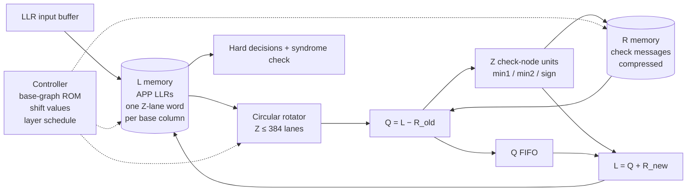

# 00 · The Application: What Are We Building?

> **Goal:** See where the LDPC decoder sits in a 5G receiver, what it takes in and hands out, and why its hardest hardware problem is moving data rather than computing on it.
>
> * **In one sentence:** A 5G LDPC decoder takes a block of noisy *soft* bits from the radio and returns the most likely original data bits. It does this by passing small numbers back and forth along a fixed, sparse wiring pattern, and that wiring pattern is made almost entirely of circular shifts.
> * **Paper:** the Song/Cui/Wang circular-shift network paper next to this repo (§4).

---

## 1. Where the Decoder Sits in a 5G Receiver

Before looking inside the decoder, it helps to know what feeds it and what consumes its output. The receive chain below runs top to bottom:

```
antenna → RF/ADC → OFDM demod → channel estimation/equalization
        → demapper (QAM symbols → soft bits, "LLRs")
        → rate recovery (de-interleave, undo puncturing/repetition, insert known zeros)
        → ┌────────────────────┐
          │    LDPC DECODER    │   ← this tutorial
          └────────────────────┘
        → CRC check → HARQ (ask for retransmission if CRC fails) → MAC / higher layers
```

How to read the chain:

* **Upstream (demapper and rate recovery):** The demapper turns QAM symbols into soft bits (LLRs), and rate recovery undoes the transmitter's interleaving, puncturing and repetition, inserting known zeros, so the decoder receives one LLR per code-block bit.
* **The decoder (boxed):** This is the only block this tutorial builds.
* **Downstream (CRC and HARQ):** The CRC check decides whether the decoded block is good. If it fails, HARQ asks the transmitter for a retransmission.

The transmitter added parity bits to every *code block* using an LDPC code. **The receiver's job is to use those parity bits to repair errors the channel introduced.**

## 2. What Goes In and What Comes Out

Each code block arrives with its LLRs plus a handful of configuration values that tell the decoder which code was used and how hard to try:

**Input, per code block:**

| Item | What it is | Typical form in hardware |
|---|---|---|
| LLRs | one *log-likelihood ratio* per transmitted bit. Sign = best guess (positive → 0), magnitude = confidence | signed 6–8 bit integers, streamed in |
| Base graph | BG1 (large blocks, higher rates) or BG2 (small blocks, lower rates) | 1 bit |
| Lifting size Z | one of **51** legal values from 2 to 384 | 9-bit value + set index (iLS) |
| Number of rows/layers to use | depends on the code rate the transmitter chose | small integer |
| Max iterations | latency/quality trade-off | small integer |

The output is much smaller: the decoded data bits and a status report.

**Output, per code block:**

| Item | What it is |
|---|---|
| K decoded bits | the hard decisions on the information part |
| Status | did all parity checks pass? how many iterations were used? |

## 3. What the Decoder Must Do (Functional Spec)

Functionally, the decoder runs four steps:

1. **Store:** Write the incoming LLRs into an internal memory (the *APP* or *L* memory).
2. **Iterate:** For each parity-check row of the code, read the bits that row involves, compute corrections with a simple min/sign rule (Min-Sum, chapter 01), and write updated LLRs back.
3. **Stop:** Finish when every parity check is satisfied or the iteration limit is hit.
4. **Output:** Return the signs of the information LLRs.

The arithmetic in step 2 is small: subtract, compare, find the two smallest magnitudes, XOR signs, add. **The hard part is the data movement.**

Each row needs a different set of LLRs, and they arrive in the wrong order. They have to be rearranged before the compute lanes can use them, and rearranged back afterwards. In 5G that rearrangement is always a **circular rotation of a Z-element vector**. The amount of rotation is different for every block, and Z itself changes from one code block to the next.

## 4. Why This Is a Hardware Design Problem

That one operation, "rotate a Z-element vector by a shift that keeps changing", runs into every constraint a real 5G decoder has. Each requirement below turns into a concrete demand on the RTL:

| Requirement | Consequence for the RTL |
|---|---|
| 51 different Z values | the rotator must rotate *any* length ≤ 384, not just a power of two |
| Z changes per code block | everything is run-time configurable; no per-Z hardware |
| Shift changes every cycle | the rotator is combinational/pipelined, reconfigured every clock |
| Gb/s throughput | Z lanes (up to 384) work in parallel, so the rotator moves 384 × W bits per cycle |
| Small Z is common too | at Z = 24 a 384-lane design is 94% idle unless it can process several code blocks at once ("multi-frame") |
| Rotator is on the critical path | its depth and its *control logic* set the clock frequency |

This is why so many papers exist about "circular-shift networks". The Song/Cui/Wang paper next to this repo is one of them.

## 5. Block Diagram

Here is the whole decoder at block level. The rotator sits between the L memory and the arithmetic:



How to read the diagram:

* **The main loop (solid arrows):** L memory → rotator → `Q = L − R_old` → check-node units → `L = Q + R_new` → back into L memory. The Q FIFO holds Q while the check-node units work.
* **The R memory:** It stores the check messages in compressed form, supplies `R_old` to the subtractor, and receives the new messages from the check-node units.
* **The controller (dashed arrows):** It drives the rotator, the L memory and the R memory from the base-graph ROM, the shift values and the layer schedule.
* **The exit:** L memory also feeds the hard decisions and the syndrome check.

Chapter 07 walks through every box. Chapters 02–06 are about the box labelled **Circular rotator**, because that is the part you said you have never built.

## 6. Scope of This Tutorial

* **In scope:** What the rotator must compute, the switching-network theory needed to build it, four tested rotator RTL designs, how the rotator plugs into a layered decoder, and a milestone plan for building the rest.
* **Out of scope here** (pointers given in chapter 09): Rate recovery, HARQ combining, CRC, encoder design, and BER/BLER performance tuning.

## 7. Exercises

1. **Fixed wiring:** Why can't the decoder simply use a fixed wiring between memory and compute lanes?
2. **Where the silicon goes:** Which costs more silicon in a 5G decoder: the arithmetic or the data movement?

### Solutions to Selected Exercises

> **Solution to Exercise 1:** Because each base-matrix block has its own shift value, and Z changes per code block. The connection pattern changes from cycle to cycle, so it has to be a configurable network.

> **Solution to Exercise 2:** Usually the memories first, then the data movement (rotators plus their control). The per-lane arithmetic (a few adders and comparators) is small. Chapter 07 has the numbers.
