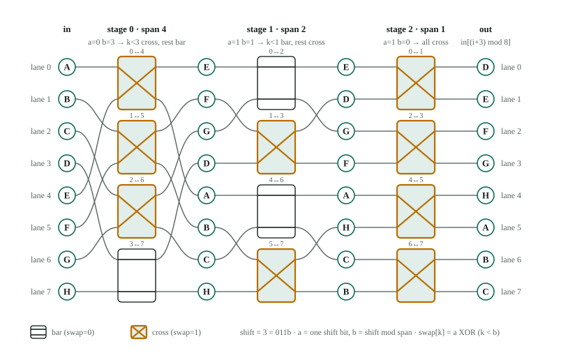

# 03 · Switching basics for RTL engineers

> Goal: the vocabulary and mental models of switching networks, built up from
> the 2:1 mux you already know. After this chapter, "a rearrangeably
> non-blocking Benes network" and "a Banyan has the unique-path property" will
> mean something concrete.

---

## 1. The problem a switching network solves

You have N input lanes and N output lanes. Each cycle you want a
**permutation**: every output takes exactly one input and every input goes to
exactly one output. The network's **configuration** (its control bits) decides
which permutation you get.

Three things decide whether a network is a good fit:

| Question | Metric |
|---|---|
| Which permutations can it make? | *capability*: all N!? only rotations? |
| How big and how deep is the datapath? | *cost*: mux count × W bits; *depth*: mux levels on the critical path |
| How hard is it to work out the control bits from what you want? | *control complexity*: often the hidden cost |

The third row is easy to overlook, and it is the main topic of the Song et al.
paper.

## 2. From mux to 2×2 switch

A **2×2 switch** has two inputs, two outputs, and one control bit:

```
   bar (swap=0)            cross (swap=1)

 in0 ───────── out0       in0 ─╲   ╱─ out0
                                 ╳
 in1 ───────── out1       in1 ─╱   ╲─ out1
```

In RTL it is just **two 2:1 muxes sharing a select**:

```verilog
assign out0 = swap ? in1 : in0;
assign out1 = swap ? in0 : in1;
```

(`rtl/switches.v`. The word `cross` is reserved in SystemVerilog, so the port
is called `swap`.)

A **3×3 rotating switch** (used in chapter 06) takes three inputs and produces
one of the three cyclic orders `(0,1,2)`, `(1,2,0)`, `(2,0,1)`. It is three 3:1
muxes with a 2-bit control.

## 3. The crossbar: maximum flexibility, maximum cost

```
          in0  in1  in2  in3
out0  ──── ●────●────●────●      each output = one N:1 mux
out1  ──── ●────●────●────●      N² crosspoints
out2  ──── ●────●────●────●      any permutation, even broadcast
out3  ──── ●────●────●────●      control: log2 N select bits per output
```

* Cost N² (≈ N(N−1) 2:1 muxes), depth ⌈log2 N⌉ mux levels.
* Control is trivial *if* you already know, for every output, which input it wants.
* Fine for N = 8. At N = 384 it costs about 147k muxes per bit (chapter 02).

## 4. Multistage networks: trading flexibility for cost

The idea: instead of one huge stage, use **several stages of small switches**
with fixed wiring between them. Typically there are log2 N stages of N/2
2×2 switches each.

### Counting argument: how many switches do you need for *every* permutation?

A network with S binary switches has at most 2^S configurations. To produce
all N! permutations you need

```
2^S ≥ N!   ⟹   S ≥ log2(N!) ≈ N·log2 N − 1.44·N
```

| N | log2(N!) | Banyan switches (N/2)·log2 N | Benes switches (N/2)(2·log2 N − 1) |
|---|---|---|---|
| 8 | 15 | 12 | 20 |
| 64 | 296 | 192 | 352 |
| 384 (using ⌈log2 384⌉ = 9) | 2748 | 1728 | 3264 |

So a **Banyan** has too few switches to make every permutation; it is
*blocking*. A **Benes** has enough, and it can in fact make every permutation.
For LDPC we only need the N rotations, and a Banyan can make all of them
(chapter 06 proves this by construction).

## 5. The Banyan (butterfly) network

Built recursively. An N-lane Banyan is one column of N/2 switches followed by
**two** N/2-lane Banyans:

```
8-lane Banyan: which lanes each 2x2 switch joins

            stage 0               stage 1                stage 2
            span 4                span 2                 span 1
            (whole bus)           (each half)            (each quarter)

switches    (0,4) (1,5)           (0,2) (1,3)            (0,1) (2,3)
            (2,6) (3,7)           (4,6) (5,7)            (4,5) (6,7)

            └─ one 8-lane ─┘      └ two 4-lane Banyans ┘  └ four 2-lane ┘
```

In this tutorial's version, switch k of stage 0 joins lane k with lane k + N/2.
Each switch sends one value to the upper half and one to the lower half. The
two halves are then handled independently.

**The whole network, wired and carrying data.** The figure shows the same 8-lane
Banyan, set up to rotate A…H left by 3. The output it must produce is
`out[i] = in[(i + 3) mod 8]`, which is D E F G H A B C. Each box is one 2×2
switch. The label on a box (for example `0↔4`) gives the two lanes it joins,
and the circles show the value on every lane between stages.



Follow it stage by stage:

| Stage | Pairs | Setting for shift 3 | Lanes afterwards |
|---|---|---|---|
| in | | | A B C D · E F G H |
| 0 (span 4) | 0↔4, 1↔5, 2↔6, 3↔7 | first three cross, last bar | E F G D · A B C H |
| 1 (span 2) | 0↔2, 1↔3 in each half | first bar, second cross | E D G F · A H C B |
| 2 (span 1) | 0↔1, 2↔3, … | all cross | **D E F G · H A B C** |

What the figure shows:

* **Every stage has the same hardware:** four 2×2 switches, which is 8 two-input
  muxes per data bit. Three stages give `(N/2)·log2 N = 12` switches. Only the
  wiring span changes: 4, then 2, then 1.
* **Stage 0 sorts values into halves.** After it, the upper half holds E F G D.
  These are exactly the four values that outputs 0–3 need (D E F G), just in
  the wrong order. The lower half likewise holds the four values for outputs
  4–7.
* **The two halves never mix again.** Stages 1 and 2 are two separate 4-lane
  Banyans. Both of them rotate their half left by `3 mod 4 = 3`. This is the
  recursion from the start of this section.
* **Control is cheap and shared.** In every stage, switch k's setting follows
  one rule, `swap = a XOR (k < b)`. Here `a` is one bit of the shift and `b` is
  the shift mod the span, which is just the lower bits of the shift. Both halves
  of stage 1 get the *same* control vector. Chapter 06 derives this rule. For
  now, notice that the rule only ever produces a run of switches with one
  setting followed by a run with the other ("first three cross, last bar"),
  never an arbitrary pattern.

To try other shifts, open the **Rotator lab** on the web page (`site/serve.sh`),
pick Banyan, and change the shift. It shows the lane values after every stage.

**Unique-path property.** From any input to any output there is exactly one
route. At each stage the route must turn toward the half that contains the
destination. That makes routing simple: each switch decides from local
information. It also makes the network *blocking*: when two values need the
same internal link, one of them loses.

**Blocking example (N = 4).** A 4-lane Banyan has 4 switches, so 2^4 = 16
configurations, but there are 24 permutations. Ask for output order
**A C B D** (lane 0 ← A, lane 1 ← C, lane 2 ← B, lane 3 ← D):

* Stage 0 pairs lanes (0,2) = (A,C) and (1,3) = (B,D).
* Outputs 0 and 1 (the upper half) need **A and C**. Both are in the *same*
  stage-0 switch, which can send only one value up. **Blocked.**

Enumerating all 16 configurations (try it in Python) shows that 8
permutations are unreachable: ACBD, ACDB, BDAC, BDCA, CABD, CADB, DBAC, DBCA.
All four **rotations** (ABCD, BCDA, CDAB, DABC) are reachable. That is the
property LDPC relies on.

**Why a Banyan instead of a barrel shifter, when both cost N·log2 N?**
Its recursive structure. If the first f stages are forced to "bar", the
network splits cleanly into 2^f independent smaller rotators. That is how one
384-lane network can process several small code blocks at once (chapter 06).

## 6. The Benes network

A Benes network is a Banyan followed by a mirrored Banyan, sharing the middle
stage: 2·log2 N − 1 stages.

```
 input        upper N/2 Benes         output
 switch  ──►                      ──► switch
 column  ──►  lower N/2 Benes     ──► column
```

* **Rearrangeably non-blocking**: it can realise *any* permutation, provided
  you are allowed to choose all switch settings together. Some other
  permutation's settings may have to be rearranged first, hence "rearrangeably".
* For a datapath that is reconfigured from scratch every clock,
  "rearrangeable" is all you need. (*Strictly* non-blocking, where new
  connections never disturb existing ones, matters in telephone switches,
  not here.)
* **The catch is control.** Finding switch settings for an arbitrary
  permutation needs the *looping algorithm*, a sequential procedure that is
  hard to do in one clock cycle. Hardware usually precomputes the settings and
  stores them in a ROM.

Huang & Walrand (arXiv 1208.0561, next to this repo) use exactly this topology
(their Fig. 2 and Section III-A) to connect servers in a data center. The rest
of their paper is about queues and scheduling packets through it. For LDPC
the key point is simple: **a Benes network can do far more than rotations,
and you pay for that in stages and control logic.** That is why LDPC decoders
use Banyan-type networks or barrel shifters.

## 7. Shift vs rotate

| Operation | Lane i receives | Lanes that "fall off" |
|---|---|---|
| logical left shift by s | x[i + s] or 0 | lost; zeros come in |
| left **rotate** by s | x[(i + s) mod N] | wrap around to the other end |

Chapter 05 builds a variable-size rotator out of two *shifters*, so keep both
in mind.

## 8. Vocabulary summary

| Term | Meaning |
|---|---|
| lane / port | one W-bit data element position |
| stage | one column of switches; one mux level of delay |
| bar / cross | the two states of a 2×2 switch |
| configuration | the full set of control bits for one cycle |
| blocking | some permutations are impossible because two paths need one link |
| rearrangeably non-blocking | every permutation is possible if all switches are set together |
| unique path | exactly one route from each input to each output (Banyan) |
| control generation | the logic that turns "shift by s, size Z" into switch bits |
| multi-frame | splitting one network into several independent smaller ones |

---

### Check yourself

<details><summary>A 2×2 switch is two 2:1 muxes. How many 2:1 muxes per bit does an 8-lane Banyan use, and how many does an 8-lane barrel rotator use?</summary>

Banyan: 3 stages × 4 switches × 2 = 24. Barrel: 3 stages × 8 lanes = 24.
They are the same. The two differ in structure and control, not in mux count.
</details>

<details><summary>Why is a Benes network overkill for a QC-LDPC decoder?</summary>

It can make all N! permutations, but QC-LDPC needs only rotations. You would pay
about twice the stages, plus a hard control problem (the looping algorithm),
for flexibility you never use.
</details>
