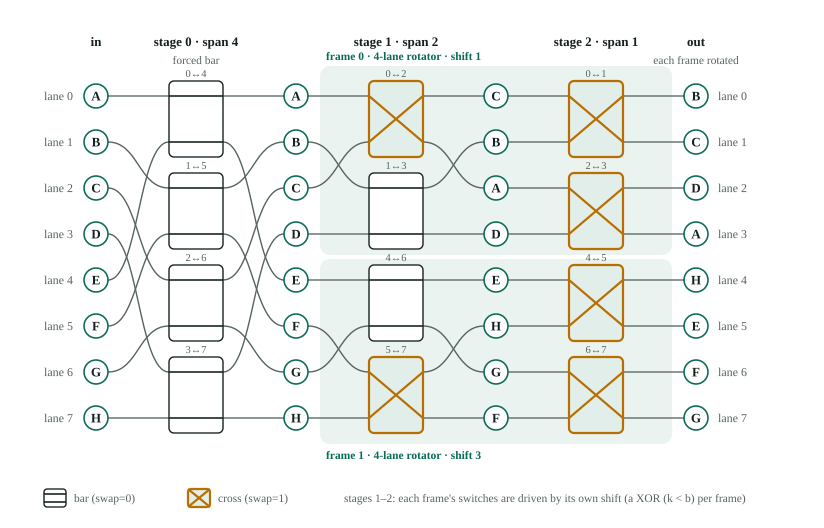
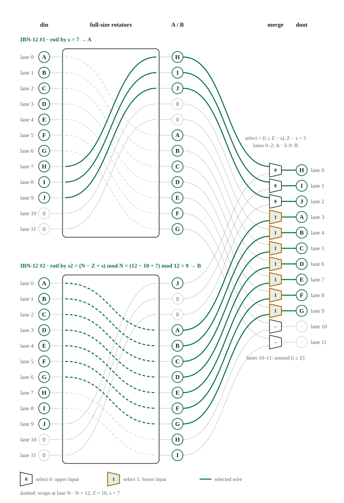

# 06 · Banyan, IBN, and the 5G LDPC Rotator

> **Goal:** Understand from the ground up how a Banyan network rotates data and how its control bits are generated. Then, scale that design to 384 lanes (3 × 128) using the Improved Banyan Network (IBN) from the Song/Cui/Wang paper, and assemble a complete, multi-frame 5G LDPC rotator.
>
> * **RTL:** `rtl/rot_banyan.v`, `rtl/rot_ibn3.v`, `rtl/rot_5g.v`
> * **Python Model:** `rotl_banyan`, `rotl_ibn`, `rotl_bypass`, `rotl_banyan_multiframe`

## 1. Why Bother When the Barrel Rotator Already Works?

In an LDPC decoder, the rotator's job is to cyclically shift batches of Z messages by a shift amount s. A classic barrel rotator does this easily, so why replace it with a Banyan network?

There are two big practical reasons (first introduced in Chapter 04 §6):

1. **Multi-frame parallelism:** A Banyan network can be cleanly partitioned into several smaller, independent rotators. When decoding small lifting sizes (Z ≪ 384), you can pack multiple frames side by side and rotate each by a *different* shift at the same time—keeping all 384 lanes busy instead of leaving 90% of your hardware idle.
2. **Natural fit for non-power-of-two sizes:** The maximum lifting size in 5G NR is Z_max = 384 = 3 × 2^7. By pairing a radix-3 stage with power-of-two Banyan sub-networks, we can match 384 lanes with zero wasted wires.

**The catch:** Unlike a barrel rotator—where the raw bits of the shift value s directly drive each stage's multiplexers—a Banyan network's 2 × 2 switches require **computed control bits**. The central engineering challenge is generating those control bits quickly and with minimal gate area. That is the core problem solved in this chapter.

## 2. Deriving the Banyan Rotator from Scratch

### Step 1: What a Left Rotation Looks Like on the Wires

We want to build an N-lane network that rotates its inputs **left by s lanes**. Any value pushed off the top (lane 0) wraps around to the bottom (lane N-1).

You can look at this rotation in two equivalent ways:

* **From the output's perspective:** Output lane i pulls its value from input lane (i + s) mod N.
* **From the input's perspective:** Input lane j sends its value to output lane (j - s) mod N.

Hardware multiplexers naturally use the first perspective because each output lane needs to know which input lane to select.

For example, with N = 8 lanes and a left shift of s = 5:

```
Lane index:   0   1   2   3   4   5   6   7
Input (x):    A   B   C   D   E   F   G   H
Output:       F   G   H   A   B   C   D   E
```

Notice how `H` starts on input lane 7 and lands on output lane (7 - 5) = 2. Equivalently, output lane 2 reads input lane (2 + 5) = 7.

### Step 2: Divide and Conquer (Splitting the Shift)

Instead of routing every lane to every possible destination at once, we split the N-lane rotation into two halves of size H = N/2.

Any shift s (from 0 to N-1) can be broken into at most **one full half-shift** (H) plus a **remainder** (b) that is smaller than a half:

```
s = a·H + b     where:  a ∈ {0, 1}       (the top bit of s)
                        b ∈ {0 .. H−1}   (the remaining lower bits of s)
```

In our N = 8, s = 5 example, H = 4. Since 5 = 1 · 4 + 1, we get:

* a = 1 (one full swap of the two 4-lane halves)
* b = 1 (an extra left shift by 1 lane inside each half)

Because H is a power of two, extracting a and b requires **zero arithmetic**—a is just the most significant bit of s, and b is the slice of remaining lower bits.

### Step 3: Building the Network Recursively

Splitting s = a · H + b lets us build an N-lane rotator in two steps:

1. **Stage 0 (the sorting stage):** A column of H parallel 2 × 2 switches. Switch k pairs lane k (in the upper half) with lane k + H (in the lower half). Each switch either passes its two inputs straight through (**bar**, `swap = 0`) or trades them (**cross**, `swap = 1`).
2. **Two independent H-lane rotators:** One for the upper half (lanes 0 … H-1) and one for the lower half (lanes H … N-1). Both sub-rotators shift their respective halves left by the **exact same remainder b**.

Here is the key insight: **once a value enters one of the H-lane half-rotators, it can never leave that half.** Therefore, Stage 0 has only one job: **put every input value into the half where it will ultimately live.** The two half-rotators then slide the values into their final positions within each half.

We then apply the exact same trick inside each H-lane rotator (splitting it into H/2-lane rotators), repeating until we reach 1-lane wires. That recursive halving *is* the Banyan network.

### Step 4: How Should Switch k Decide Between `bar` and `cross`?

Look at position k (where k ∈ {0 … H-1}) right after Stage 0. Switch k must decide whether to leave the upper and lower inputs in their original halves (`bar`) or trade them (`cross`). Two factors control this decision:

1. **The half-shift bit (a):** If a = 1, the shift is at least H lanes, which means the entire upper and lower halves trade places. By default, a = 1 wants every switch to **cross**, while a = 0 wants every switch to stay **bar**.
2. **The wrap-around remainder (b):** Next, each half-rotator shifts its lanes up (left) by b positions:
   * **Lanes k ≥ b do not wrap:** They simply move up by b spots and stay inside the same half. For these switches, the default decision from a stands.
   * **Lanes k < b wrap around:** When the half-rotator shifts left by b, the top b lanes (k = 0 … b-1) fall off the top of the half and wrap around to the bottom of that *same* half. However, in a true N-lane rotation, a value that falls off the top of the lower half belongs at the bottom of the *upper* half (and vice versa). To make sure the right values wrap into the right halves, **any lane that wraps (k < b) must come from the opposite input half**. In other words, whenever k < b, we **flip** the decision of a!

Combining both rules gives the fundamental Banyan control equation for switch k:

```
swap[k] = a XOR (k < b)        (1 = cross, 0 = bar)
```

Let's test this formula on our example (N = 8, s = 5 ⇒ H = 4, a = 1, b = 1):

```
k = 0:  (0 < 1) is 1 (wraps!)   →  swap[0] = 1 XOR 1 = 0 (bar)
k = 1:  (1 < 1) is 0 (no wrap)  →  swap[1] = 1 XOR 0 = 1 (cross)
k = 2:  (2 < 1) is 0 (no wrap)  →  swap[2] = 1 XOR 0 = 1 (cross)
k = 3:  (3 < 1) is 0 (no wrap)  →  swap[3] = 1 XOR 0 = 1 (cross)

Result: swap = [0, 1, 1, 1]
```

> **Optional Proof Using Index Algebra:**
> Output lane q · H + j (in half q ∈ {0, 1}, at intra-half position j ∈ {0 … H-1}) must receive input x[(qH + j + s) mod N]. Because half q is rotated left by b after Stage 0, whatever Stage 0 places at intra-half position k will end up at output position j = (k - b) mod H:
> * **Case 1 (k ≥ b, no wrap, so j = k - b):** Position k must hold x[(qH + (k - b) + (aH + b)) mod N] = x[((q + a) mod 2) · H + k]. That is lane k of input half (q + a) mod 2.
> * **Case 2 (k < b, wraps, so j = k - b + H):** Position k must hold x[(qH + (k - b + H) + (aH + b)) mod N] = x[((q + a + 1) mod 2) · H + k]. That is lane k of the *other* input half, (q + a + 1) mod 2.
>
> In both cases, position k needs input lane k from one of the two halves—which is the exact pair connected to switch k! The selection between the two halves is (q + a + (k < b)) mod 2, meaning switch k crosses when a ⊕ (k < b) = 1.

### Visual Walkthrough of One Level (N = 8, s = 5)

The diagram below shows the first recursive split. Stage 0 is drawn switch-by-switch on the left (`swap = [0, 1, 1, 1]`). To its right, the two dashed outlines are the two 4-lane half-rotators, each shifting left by b = 1. A dashed outline is a sub-network, not a 4 × 4 switch: inside, each one is two more stages of 2 × 2 switches, which Section 3 opens up.

![One level of the Banyan recursion at N = 8, s = 5: stage 0 with swap = [0,1,1,1] sorts A to H into halves A F G H and E B C D, then two 4-lane rotators each rotate left by 1. Generated by figures/make_banyan_split8.py, which checks the result against rotl_banyan.](figures/banyan_split8.svg)

The easiest way to verify the figure is to **trace it backward from the outputs**:

1. **See what each output half needs:**
   * The upper output half (lanes 0–3) needs `F G H A`.
   * The lower output half (lanes 4–7) needs `B C D E`.
2. **Undo the b = 1 half-rotation:**
   * Because the upper 4-lane rotator shifts its inputs (`u0 u1 u2 u3`) left by 1 to produce `u1 u2 u3 u0`, we must feed it **`A F G H`** so that rotating left by 1 yields **`F G H A`**.
   * Notice how `A` (at position k = 0) wraps to the bottom of the upper half (output lane 3), while `F, G, H` simply step up by one lane.
3. **Match what Stage 0 must deliver to the upper half:**

| Switch k | Upper Half Needs | Input Lane Location | Which Input Half? | Why? (`swap[k] = a XOR (k < b)`) |
| :--- | :--- | :--- | :--- | :--- |
| **0** | `A` | Lane 0 | Upper (**bar**, `0`) | k < 1: Wraps! Flips a=1 → 0 |
| **1** | `F` | Lane 5 | Lower (**cross**, `1`) | k ≥ 1: No wrap. Keeps a=1 |
| **2** | `G` | Lane 6 | Lower (**cross**, `1`) | k ≥ 1: No wrap. Keeps a=1 |
| **3** | `H` | Lane 7 | Lower (**cross**, `1`) | k ≥ 1: No wrap. Keeps a=1 |

4. **The lower half comes for free:** Because each 2 × 2 switch is a permutation, sending `A F G H` to the upper half automatically sends the remaining inputs **`E B C D`** to the lower half. When the lower 4-lane rotator shifts `E B C D` left by b = 1, it outputs **`B C D E`**—completing `F G H A B C D E`!

## 3. Worked Example: Opening Up All Three Stages (N = 8, s = 5)

Let's trace the data forward through the entire 8-lane network for s = 5 (101₂).

### Stage 0 (8-lane block, H = 4)

Here s = 5 = 1 · 4 + 1 ⇒ a = 1, b = 1, and `swap = [0, 1, 1, 1]`:

```
Input:                  A B C D | E F G H
Stage 0 (swap=[0,1,1,1]):
  Switch 0 (A,E) bar  → upper[0] = A, lower[0] = E
  Switch 1 (B,F) swap → upper[1] = F, lower[1] = B
  Switch 2 (C,G) swap → upper[2] = G, lower[2] = C
  Switch 3 (D,H) swap → upper[3] = H, lower[3] = D
After Stage 0:          A F G H | E B C D
```

### Stages 1 and 2 (Opening the 4-lane and 2-lane sub-rotators)

Now both 4-lane halves (`A F G H` and `E B C D`) need to rotate left by s = 1. We simply apply the exact same formula (`swap[k] = a XOR (k < b)`) with H = 2 for Stage 1, and H = 1 for Stage 2:

```
Stage 1 (4-lane blocks, H = 2):
  Shift needed is 1 = 0·2 + 1  →  a = 0, b = 1
  swap = 0 XOR (k < 1) = [1, 0]   (Switch 0 crosses, Switch 1 stays bar)
  • Upper block (A F G H): pairs (0,2) cross, (1,3) bar  →  G F A H
  • Lower block (E B C D): pairs (4,6) cross, (5,7) bar  →  C B E D

Stage 2 (2-lane blocks, H = 1):
  Shift needed is 1 = 1·1 + 0  →  a = 1, b = 0
  swap = 1 XOR (k < 0) = [1]      (Every 2x2 switch crosses)
  • All four 2-lane blocks swap adjacent pairs:
    G F | A H | C B | E D   →   F G | H A | B C | D E

Final Output:           F G H A B C D E   ✓
```

Here is the complete 3-stage network in action. The two shaded panels are the two 4-lane half-rotators, now drawn switch by switch:

![8-lane Banyan rotating A to H left by 5 with all three stages expanded: stage 0 swap [0,1,1,1], stage 1 swap [1,0] in both blocks, stage 2 all cross. Generated by figures/make_banyan8_s5.py, which checks every intermediate column against the trace above and rotl_banyan.](figures/banyan8_s5.svg)

### Four Key Takeaways from the Full Diagram

* **The two shaded panels are the dashed sub-rotators from Section 2, opened up:** Each 4-lane block consists of Stage 1 (which splits the 4 lanes into two 2-lane halves) and Stage 2 (which swaps pairs inside each 2-lane block).
* **Every block in the same stage shares the exact same switch settings:** Look at Stage 1: in *both* the upper and lower 4-lane blocks, the first switch crosses (`0↔2` and `4↔6`) and the second switch stays bar (`1↔3` and `5↔7`). Because both halves received the same remainder b from Stage 0, we only need to compute the control signals **once per stage** and broadcast them to every block in that column!
* **Each stage consumes one bit of the shift s:** With s = 5 = 101₂:
  * Stage 0 uses s[2] = 1 as a, and s[1:0] = 01₂ = 1 as b.
  * Stage 1 uses s[1] = 0 as a, and s[0] = 1₂ = 1 as b.
  * Stage 2 uses s[0] = 1 as a, and has no lower bits left (b = 0).
* **Wires never cross a block boundary once it has been split:** After Stage 0, no wire ever crosses between the upper panel (lanes 0–3) and the lower panel (lanes 4–7). After Stage 1, no wire crosses between the pairs 0–1, 2–3, 4–5 and 6–7. This strict isolation is what makes **multi-frame mode** (Section 5) possible.

## 4. Hardware Control Generation and Wire Sharing

Let's formalize the control logic for stage d (where d = 0 … log₂N - 1).

At stage d, there are 2^d blocks, each of size B = N / 2^d, and each switch spans H = B / 2 lanes. In standard single-frame mode, every block at stage d shares the same (a_d, b_d):

```
a_d       = shift[n − 1 − d]        // 1 bit: just a wire tap from shift
b_d       = shift & (H − 1)         // Lower bits of shift: zero arithmetic!
swap_d[k] = a_d XOR (k < b_d)       // k = 0 .. H−1, shared across all 2^d blocks
```

### Why `(k < b_d)` Is So Cheap: Thermometer Decoding

Computing `(k < b_d)` for k = 0 … H-1 is known as a **thermometer decoder**: if b_d = 3, the outputs for k = 0, 1, 2 are `1` and all higher k are `0` (like mercury rising in a thermometer).

Because k is a **fixed hardware constant** for each wire, comparing `b_d` against `k` is just a compare-with-constant circuit that logic synthesis collapses into a handful of gates. Across all stages combined, the total number of thermometer bits is:

```
N/2 + N/4 + … + 1 = N − 1
```

**Notice what is completely absent:** There are no modulo circuits, no subtractors, and no lookup tables. Everything works by bit-slicing because every block size is a power of two. (Keep this in mind when we hit N = 384 in Section 6!)

### Inside the Control Generator (N = 8, s = 5)

The diagram below shows the entire control generator for our 8-lane example, arranged with one column per stage:

![Control generator of an 8-lane Banyan for shift 5: for each stage one shift bit is a, the low bits are b, a thermometer decoder makes t[k] = (k < b), an XOR per k makes swap[k], and each swap wire drives switch k in every block. Generated by figures/make_banyan_ctrl8.py, which feeds the swaps through the switch network and checks the rotation.](figures/banyan_ctrl8.svg)

Follow any column from top to bottom:

1. **Slice the shift bits (free wiring):** `a_d` taps a single bit (`s[2]` for Stage 0, `s[1]` for Stage 1, `s[0]` for Stage 2), while `b_d` slices the bits below it (the tinted cells). The faded cells are bits that this stage does not use.
2. **Thermometer decode b_d:** Generate t[k] = (k < b_d). For b_d = 1, only t[0] = 1 and the rest are `0` (`[1, 0, 0, 0]` in Stage 0; `[1, 0]` in Stage 1). In Stage 2, H = 1, so b₂ has zero bits and t[0] is permanently `0`.
3. **XOR with a_d:** When a_d = 0, `swap` equals t; when a_d = 1, `swap` is the bitwise inverse of t. Thus Stage 0 turns `[1, 0, 0, 0]` into `[0, 1, 1, 1]`.
4. **Broadcast (`fan-out`) to the switches:** Each `swap[k]` wire drives the k-th switch of *every* block in that stage:
   * **Stage 0** (1 block): 4 control wires drive 4 switches (fan-out = 1).
   * **Stage 1** (2 blocks): 2 control wires drive 4 switches (fan-out = 2).
   * **Stage 2** (4 blocks): 1 control wire drives all 4 switches (fan-out = 4).

### Hardware Cost & Verilog Implementation

For N = 128, the entire control generator needs only 128 - 1 = 127 small constant-comparators and 127 XOR gates to drive 64 × 7 = 448 switches. The only physical design detail to watch is **fan-out** on the late stages (Stage 6's single `swap[0]` wire drives 64 switches), which synthesis tools handle automatically with buffer trees.

Here is the core loop from `rtl/rot_banyan.v`:

```verilog
localparam [SW-1:0] MASK = {SW{1'b1}} >> (d + 1);   // Mask for (H - 1)
wire          a = shift[SW-1-d];
wire [SW-1:0] b = shift & MASK;

for (k = 0; k < H; k = k + 1)
    assign swap[k] = a ^ (k < b);

// Instantiate N/2 2x2 switches for stage d:
// Switch (j*B + k, j*B + k + H) in block j is driven by swap[k]
```

**Datapath mux count:** An N-lane Banyan uses (N/2)·log₂N switches, or N·log₂N 2:1 multiplexers per bit—**the exact same datapath area as a barrel rotator**.

## 5. Multi-Frame Mode: One Rotator, Many Independent Shifts

Why can a Banyan network split into independent smaller rotators when a barrel rotator cannot? Look at which lanes each stage connects in an 8-lane Banyan:

| Stage d | Block Size | Switch Pairs Connected | Boundaries Crossed |
| :--- | :--- | :--- | :--- |
| **Stage 0** | 8 lanes | `0↔4`, `1↔5`, `2↔6`, `3↔7` | Crosses the **halfway midline** (lanes 0–3 ↔ 4–7) |
| **Stage 1** | 4 lanes | `0↔2`, `1↔3` and `4↔6`, `5↔7` | Crosses **quarter boundaries** (0–1 ↔ 2–3, 4–5 ↔ 6–7) |
| **Stage 2** | 2 lanes | `0↔1`, `2↔3`, `4↔5`, `6↔7` | Swaps **adjacent lanes** inside each pair |

Notice the hierarchy: **Stage 0 is the only stage in the entire network whose wires cross the halfway midline.**

What happens if we force every switch in Stage 0 to **`bar` (`swap = 0`)**?

* Nothing can cross between the upper half (lanes 0–3) and the lower half (lanes 4–7).
* The remaining stages (Stages 1 and 2) form **two completely isolated 4-lane Banyan rotators**!
* Similarly, if we force the first f stages to `bar`, the N-lane network splits into **2^f independent rotators**, each of size N / 2^f.

### Giving Each Frame Its Own Shift

In single-frame mode, all blocks in Stage d shared the same control signals only because they were cooperating on a single N-lane shift. The datapath wires between blocks are already physically separate!

To rotate each sub-frame by a **different shift** (s_0, s_1, …), we don't change a single datapath multiplexer. We simply give each sub-frame its own thermometer-and-XOR control generator driven by its own shift value:

```
Example: 128-lane Banyan with f = 2 (Stages 0 and 1 forced to bar)
  → Splits into 4 independent 32-lane rotators
  → Simultaneously rotates 4 frames by independent shifts s0, s1, s2, s3!
```

The Python reference model `rotl_banyan_multiframe` implements this directly, and its self-test verifies four 32-lane frames rotating simultaneously by shifts of `3`, `0`, `31`, and `17`.

### Visual Example: Two 4-Lane Frames in an 8-Lane Banyan

Below is an 8-lane Banyan with Stage 0 locked to `bar` (f = 1). In a single pass, the upper half rotates Frame 0 (`A B C D`) left by s_0 = 1 (`01₂`), while the lower half rotates Frame 1 (`E F G H`) left by s_1 = 3 (`11₂`):



Notice three things in the diagram:

1. **Zero crosstalk across the midline:** Because Stage 0 is locked to `bar`, `A–D` stay on lanes 0–3 and `E–H` stay on lanes 4–7.
2. **Independent switch patterns per block:** In Stage 1, the upper block sets its switches to `[cross, bar]` (for s_0 = 1), while the lower block sets its switches to `[bar, cross]` (for s_1 = 3).
3. **Zero extra datapath muxes:** The 2 × 2 switches are untouched—only the select-wire generation changes.

### What Multi-Frame Mode Buys You in 5G NR

* **Decode multiple small code blocks in parallel:** When Z is small, a single 384-lane datapath can decode several small code blocks (from one user or multiple users) in lockstep.
* **Process multiple base-graph columns of the same code block at once:** In a 384-lane 5G rotator (Section 6), if Z = 48, each 64-lane sub-network can carry one 48-lane vector. That lets the decoder push **six different base-matrix entries from the same layer** through the rotator in a single clock cycle—each with its own shift vector (SV). (This is why supporting *independent* shifts per frame matters: Boutillon's EBS network from Chapter 05 can split into sub-frames, but forces every frame to use the *same* shift.)

## 6. Handling N = 384: Why IBN Beats VBN

5G NR's maximum lifting size is Z_max = 384, which factors as **3 × 128** (3 × 2^7). To build a 384-lane network without wasting lanes (expanding to 512 would waste 25% of the hardware), we need seven stages of 2 × 2 switches and **one stage of 3 × 3 switches**.

Where should that 3 × 3 stage go? There are two choices—and putting it in the wrong place ruins the control logic.

### Approach 1: VBN (Variation Banyan Network, Peng et al. 2010) — 3 × 3 Stage **Last**

```
384 lanes → 2×2 stage (two 192s) → 2×2 stage (four 96s) → … → 2×2 stage (6s) → 3×3 stage (3s)
```

If you put the 2 × 2 stages first, the intermediate block sizes are 192, 96, 48, 24, 12, 6—every single one is of the form 3 · 2^j.

**Why that hurts:** Remember from Section 4 that computing the remainder b_d = s mod H is only free when H is a power of two! When H = 3 · 2^j, bit-slicing no longer works. Every stage in a VBN requires **actual hardware modulo circuits** (s mod 192, s mod 96, etc.) right on the critical timing path. Table I of the Song et al. paper reports **127 modular operations** for the reconfigurable 5G network of its reference [11].

### Approach 2: IBN (Improved Banyan Network, Song et al. 2022) — 3 × 3 Stage **First**

```
384 lanes → 3×3 stage (128 switches) → Three parallel 128-lane power-of-two Banyans
```

The IBN flips the order: put the **3 × 3 stage at Stage 0**, immediately splitting the 384 lanes into **three blocks of M = 128 lanes**.

Because M = 128 = 2^7 is a pure power of two, we can split any shift s ∈ {0 … 383} into a quotient a ∈ {0, 1, 2} and a 7-bit remainder b ∈ {0 … 127} purely by **bit-slicing**:

```
s = a·M + b     where:  a = s[8:7] ∈ {0, 1, 2}   (top 2 bits of s, since M = 128)
                        b = s[6:0] ∈ {0 .. 127}  (bottom 7 bits of s — zero arithmetic!)
```

Now apply the exact same reasoning from Section 2 to a 3-way split:

1. **Stage 0 has M = 128 parallel 3 × 3 switches.** Switch k (k = 0 … 127) connects lane k (Block 0), lane k + M (Block 1), and lane k + 2M (Block 2).
2. Instead of a 1-bit `bar`/`cross`, a 3 × 3 switch performs a **3-input cyclic left rotation** by r_k ∈ {0, 1, 2} steps:
   * If k ≥ b (no wrap inside the 128-lane block), the three blocks shift by r_k = a.
   * If k < b (wraps inside the 128-lane block), the value must come from the next block over, so the shift increments by 1: r_k = (a + 1) mod 3.

Combined into one formula:

```
r_k = (a + (k < b)) mod 3       // Drives 3×3 switch k (for k = 0 .. M−1)
```

3. **Three 128-lane Banyan networks** follow Stage 0, and all three rotate left by the exact same 7-bit remainder b = s[6:0] using standard power-of-two Banyan control!

**Why this is a breakthrough:** Because M = 128 is a power of two, **every hardware modulo on the shift value vanishes**. Even the mod 3 in r_k = (a + (k < b)) mod 3 is trivial: since a ∈ {0, 1, 2} and (k < b) ∈ {0, 1}, their sum is at most 3. Checking if a 2-bit sum equals `3` and replacing `3` with `0` takes just a couple of logic gates!

### Worked Example: 12-Lane IBN (N = 12, M = 4, s = 7)

Let's trace the 12-lane IBN from Fig. 3(b) of the paper, where N = 3 × 4 = 12 (M = 4) and we rotate left by s = 7:

1. **Bit-slice the shift:** Since M = 4, s = 7 = 1 · 4 + 3 ⇒ a = 1 and b = 3.
2. **Compute the 3 × 3 switch rotations (r_k = (1 + (k < 3)) mod 3):**
   * For k = 0, 1, 2: (k < 3) = 1 ⇒ r_k = (1 + 1) mod 3 = 2 (rotate the 3 inputs left by 2).
   * For k = 3: (3 < 3) = 0 ⇒ r_3 = (1 + 0) mod 3 = 1 (rotate the 3 inputs left by 1).
3. **Trace the lanes through the network:**


### How to Read the 12-Lane IBN Diagram

* **Each 3 × 3 switch connects corresponding lanes across the three blocks:** Switch k wires together lanes (k, k+4, k+8) and rotates those three inputs cyclically by r_k ∈ {0, 1, 2}. For instance, Switch 0 (r_0 = 2) routes `I` (from Block 2) to Block 0, `A` (from Block 0) to Block 1, and `E` (from Block 1) to Block 2.
* **Stage 0 sorts every item into its final 4-lane block:** Right after the 3 × 3 switches, Block 0 holds `{I, J, K, H}`, which are the exact four elements needed by output lanes 0–3 (`H I J K`), just waiting to be rotated left by b = 3.
* **All three 4-lane Banyans use identical control wires:** In the diagram, all three 4-lane Banyans receive b = 3 and execute the exact same switch settings (in their first stage, switch 0 is `bar` and switch 1 is `cross`; in their second stage, both switches `cross`).

> **Note on Radix-5:** This exact same architecture generalizes to N = 5 × 2^n by placing a column of 5 × 5 cyclic switches first, followed by five 2^n-lane Banyan networks. Our Python model (`rotl_ibn`) verifies `radix=5` as well.

### Verilog Implementation (`rtl/rot_ibn3.v`) and Area Check

```verilog
wire [1:0]    a = shift[SW-1:MW];          // Top 2 bits: 0, 1, or 2
wire [MW-1:0] b = shift[MW-1:0];           // Bottom MW bits (MW = 7 for M = 128)

// Per switch k (k = 0 .. M-1) of the 3x3 stage:
wire [1:0] sum = a + (k < b);              // Range: 0 .. 3
wire [1:0] r   = (sum == 2'd3) ? 2'd0 : sum; // Fast mod-3 without division!

sw3 u_sw (.in0(din[k]), .in1(din[k+M]), .in2(din[k+2M]), .r(r), ...);
// Followed by three rot_banyan #(.N(M)) instances, all driven by shift = b
```

**Datapath mux count (per bit, N = 384):**
* **Stage 0 (3 × 3 switches):** 128 switches × 3 outputs = 384 3:1 muxes ≈ 768 2:1 mux equivalents.
* **Three 128-lane Banyans:** 3 × (128 × 7) = 2,688 2:1 muxes.
* **Total:** 768 + 2,688 = 3,456 **2:1 muxes per bit**—identical to a 384-lane barrel rotator, but with multi-frame capability and near-zero control overhead!

## 7. The Complete 5G Rotator: Dual IBNs + Bypass Merge

We have one piece left to solve. A 384-lane IBN always rotates all 384 lanes as a single ring. However, 5G NR supports **51 different lifting sizes Z ≤ 384** (such as Z = 352, 256, 120, etc.).

When Z < 384, only input lanes 0 … Z-1 hold valid data; lanes Z … 383 are unused. If we simply rotate all 384 lanes left by s:

* **Output lanes 0 … Z - s - 1 get the right values:** They pull from input lanes s … Z - 1.
* **Output lanes Z - s … Z - 1 get garbage!** Instead of wrapping around to input lanes 0 … s - 1, a 384-lane rotator pulls in the unused lanes starting at lane Z.

### The Fix: Two Cyclic IBNs + a Merge Column

We can reuse the two-network merge idea from Chapter 05 (QSN), adapted for **cyclic N-lane rotators** (where N = 384):

1. **IBN #1 (`A`) rotates left by s:**
   * Produces the **unwrapped** values on output lanes 0 … Z - s - 1.
2. **IBN #2 (`B`) rotates left by s₂ = (384 - Z + s) mod 384:**
   * Why this shift works: For any wrapped output lane i ≥ Z - s, IBN #2 fetches input lane (i + 384 - Z + s) mod 384 = i - (Z - s), which is the exact wrapped input lane 0 … s - 1!
3. **Merge Network (a column of 384 2:1 muxes):**
   * For each lane i < Z, select `A[i]` if i < Z - s (unwrapped), and `B[i]` if i ≥ Z - s (wrapped).

```
           ┌──────────── IBN-384 (shift s) ───────────┐
din ──┬───►│ 3×3 stage → 3 × Banyan-128               ├──► A ─┐
      │    └──────────────────────────────────────────┘       │  Merge Muxes:
      │    ┌──────────── IBN-384 (shift s2) ──────────┐       ├─ (i < Z − s) ? A[i] : B[i] ──► dout
      └───►│ 3×3 stage → 3 × Banyan-128               ├──► B ─┘
           └──────────────────────────────────────────┘
where s2 = (384 − Z + s) mod 384   (Precomputed alongside s in the shift ROM, or
                                    computed via one adder + conditional subtract)
```

This is **Figure 6(a)** of the Song et al. paper, implemented in `rtl/rot_5g.v` and verified across all 51 5G lifting sizes and all valid shifts.

### Visual Walkthrough (N = 12, Z = 10, s = 7)

The diagram below illustrates a 12-lane version of the 5G rotator shifting a **10-element vector (Z = 10, `A` through `J`)** left by **s = 7** (leaving lanes 10 and 11 unused `0`):



Each IBN box is a full 12-lane IBN (the network in the previous figure), drawn here only by its lane mapping. Highlighted wires are the ones the merge column keeps (faint ones are discarded), and dashed wires carry values that wrap past lane N − 1. Follow the three columns from left to right:

* **IBN #1 (shifts by s = 7):** Output lanes 0–2 correctly receive `H I J` (from input lanes 7–9). However, lanes 3–4 pull in the unused `0`s from lanes 10–11, pushing `A..G` two lanes too far down.
* **IBN #2 (shifts by s₂ = 12 - 10 + 7 = 9):** By shifting 2 lanes further (7 + 2 = 9), IBN #2 skips over the two unused lanes (`10, 11`) and lines up the wrapped values `A B C D E F G` right onto lanes 3–9.
* **Merge Column (`i < Z - s`, where 10 - 7 = 3):** A thermometer decoder of `Z - s = 3` selects IBN #1 for lanes 0–2 (`H I J`) and IBN #2 for lanes 3–9 (`A B C D E F G`), outputting **`H I J A B C D E F G`**!

> **How this differs from QSN (Chapter 05):** A QSN uses two *non-circular* logical shifters (left shift + right shift), which cannot be partitioned into multi-frame sub-rotators. By using two *cyclic* IBNs instead, both rotators preserve full multi-frame support!

### Generalizing to Other Standards: The "Hybrid" Network

The paper generalizes this architecture by introducing an **Elementary Unit (EU)** of size p, where p is the **smallest lifting size Z** in a given wireless standard:

* Build each p-lane EU as a simple barrel rotator (since you never need to split a frame smaller than the minimum Z, a barrel rotator is the simplest choice and needs zero control logic).
* Stack IBN stages on top of the EUs to support multi-frame splitting, and wrap the whole structure in the Dual-Rotator + Merge bypass to support arbitrary Z.

Examples across standards:
* **5G NR (p = 2, Z_max = 384):** Since p = 2 is just a single 2 × 2 switch, the EUs merge seamlessly into the Banyan stages, giving the exact 384-lane IBN structure we built above. It supports **8 parallelism modes** and up to **192 simultaneous frames** at Z = 2.
* **Wi-Fi 802.11n (Z ∈ {27, 54, 81} ⇒ p = 27):** Three 27-lane barrel EUs placed under a single 3 × 3 IBN stage form an exact **81-lane rotator**—whereas a power-of-two Banyan would require 128 lanes and a VBN would require 96.

**Reported ASIC Results (TSMC 90 nm):** Compared to the previous state-of-the-art reconfigurable 5G network, the paper's IBN design reduces gate area by **25%**, boosts clock frequency by **33–40%**, and improves overall area efficiency by **46%**. Most of the gain comes from the much smaller and shorter controller.

## 8. Architecture Comparison (N = 384, per Data Bit)

| Network Architecture | 2:1 Mux Equiv. | Logic Depth (Mux Levels) | Control Logic Required | Supports Any Z ≤ N? | Multi-Frame (Independent Shifts)? |
| :--- | :--- | :--- | :--- | :--- | :--- |
| **Full Crossbar** | ≈ 147,000 | 9 | Per-output modulo select | Yes (with mod) | Yes |
| **Barrel Rotator (384)** | 3,456 | 9 | **None** (raw shift bits) | **No** (Z = 384 only) | **No** |
| **QSN (2 Shifters + Merge)** | ≈ 7,300 | 10 + subtractor | Subtractor + thermometer | **Yes** | **No** |
| **Banyan (512-lane, power of 2)** | 4,608 | 9 | Thermometer per stage | **No** (Z = 2^k only) | **Yes** |
| **VBN (384-lane, 3 × 3 last)** | ≈ 3,456 | 9 | **Hardware modulo per stage** | With bypass | **Yes** |
| **IBN (384-lane, 3 × 3 first)** | 3,456 | 9 | Thermometer + 2-bit add | **No** | **Yes** |
| **Dual IBN + Merge (5G Complete)** | **7,296** | **10** | **IBN ctrl + merge thermometer** | **Yes (all 51 Z)** | **Yes** |

*(Note: Mux counts come from the analytical cost functions in `model/rotators.py` for first-order architectural comparison prior to logic synthesis.)*

## 9. Exercises

1. **By-hand 4-lane trace:** Draw a 4-lane Banyan network for a left shift of s = 3. Using `swap[k] = a XOR (k < b)`, calculate the switch settings for Stage 0 and Stage 1, trace input `A B C D` through the switches, and verify the output.
2. **Multi-frame Verilog (`rtl/rot_banyan.v`):** Extend `rot_banyan.v` by adding a `frame_log2` input (`0..3`) and an array of per-frame shift inputs. Force stages d < frame_log2 to `bar` (`swap = 0`), and drive each block j in stages d ≥ frame_log2 using the shift corresponding to the frame that block j belongs to. Verify your RTL against `rotl_banyan_multiframe`.
3. **Fast mod-3 arithmetic:** In the IBN's 3 × 3 control stage, why can the expression `a + (k < b)` reach `3`, but never `4` or higher?
4. **Radix-5 IBN (`rtl/rot_ibn5.v`):** Write a Verilog module `rot_ibn5.v` for N = 5 × 2^n using a column of 5 × 5 cyclic rotating switches followed by five 2^n-lane Banyan networks. (The Python model `rotl_ibn` already supports `radix=5` for golden verification.)
5. **Reading the paper:** Look up Algorithm 2 and Equation (1) in the Song/Cui/Wang 2022 paper. Map their notation (`SV_k`, `Th_k`, and `C_k[j]`) to our variables (`b_d`, the thermometer output `t[k]`, and `swap_d[k]`). *(Hint: Check whether their network rotates left or right—see Chapter 02 §3!)*

### Solutions to Selected Exercises

> **Solution to Exercise 1:**
> For N = 4 and s = 3 (11₂):
> * **Stage 0 (H = 2):** s = 3 = 1 · 2 + 1 ⇒ a = 1, b = 1.
>   * `swap[0] = 1 XOR (0 < 1) = 1 XOR 1 = 0` (**bar**)
>   * `swap[1] = 1 XOR (1 < 1) = 1 XOR 0 = 1` (**cross**)
>   * Input `A B | C D`: Switch 0 `(A, C)` stays bar (`A` on top, `C` on bottom); Switch 1 `(B, D)` crosses (`D` on top, `B` on bottom).
>   * Intermediate halves after Stage 0: **`A D | C B`**.
> * **Stage 1 (H = 1):** Both 2-lane halves rotate by b = 1 = 1 · 1 + 0 ⇒ a = 1, b = 0.
>   * `swap[0] = 1 XOR (0 < 0) = 1 XOR 0 = 1` (**cross** for both blocks).
>   * Upper block `A D` swaps to **`D A`**; lower block `C B` swaps to **`B C`**.
> * **Final Output:** **`D A B C`**, which matches `rotl("ABCD", 3)` ✓.

> **Solution to Exercise 3:**
> Because the total shift satisfies s < 3M, the quotient a = ⌊s/M⌋ can only take values in {0, 1, 2} (never 3, even though a is a 2-bit wire). Meanwhile, the comparator output `(k < b)` is a 1-bit boolean in {0, 1}. Therefore, the maximum possible sum is 2 + 1 = 3. Since 3 mod 3 = 0, a single equality check (`sum == 3 ? 0 : sum`) computes the exact modulo-3 result without a divider.
